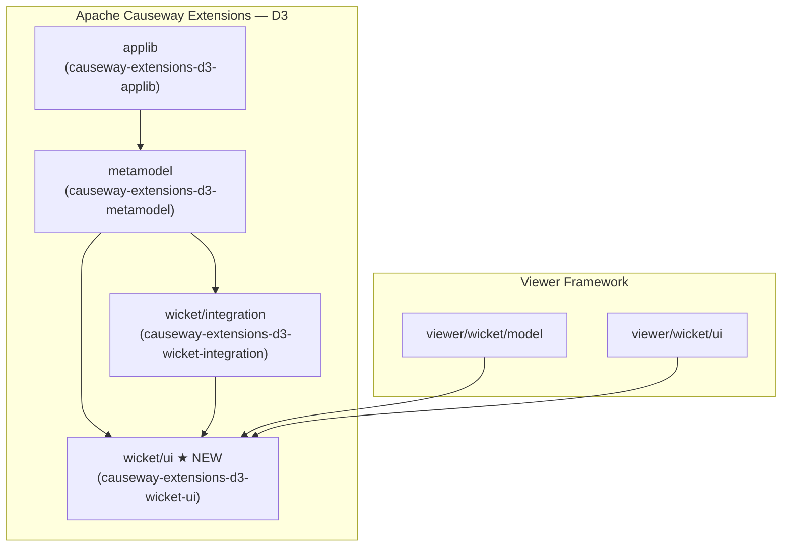
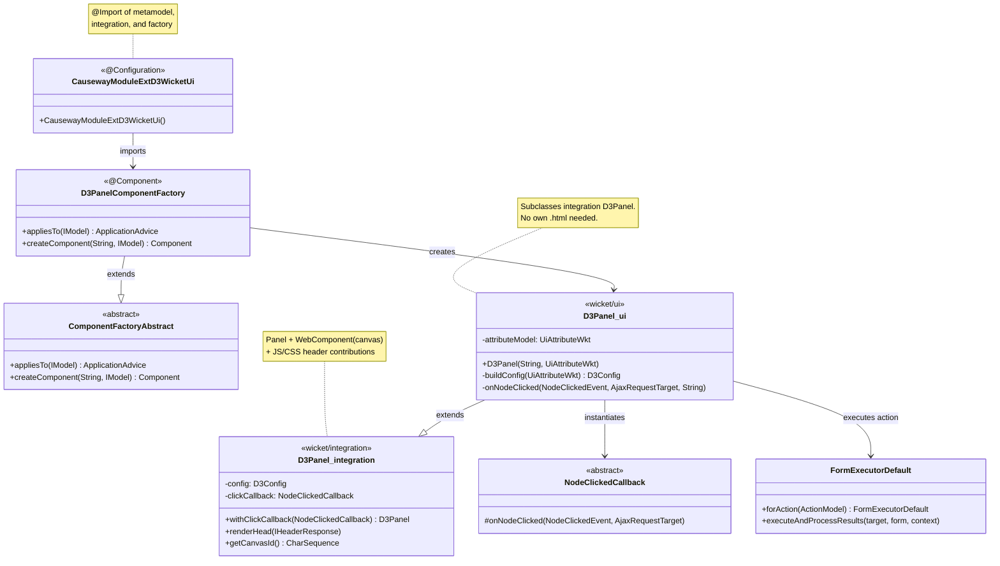
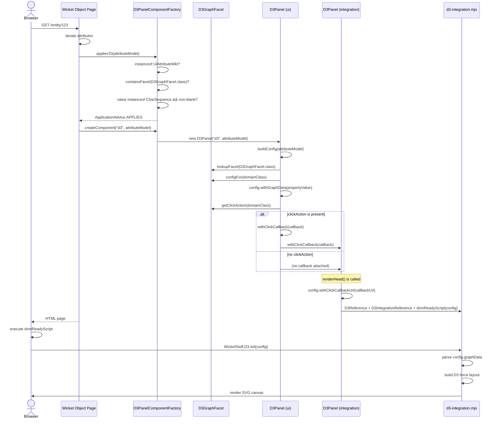
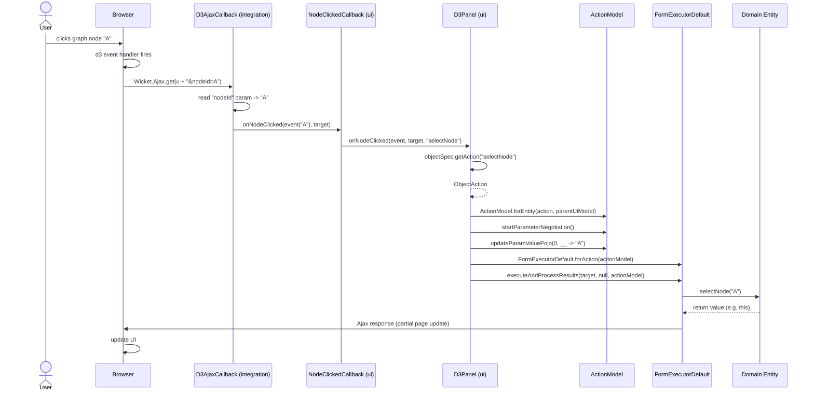
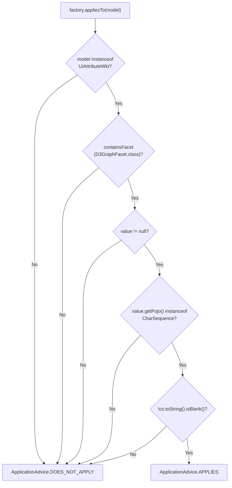
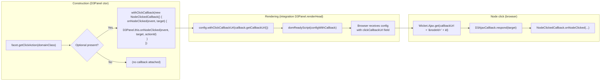
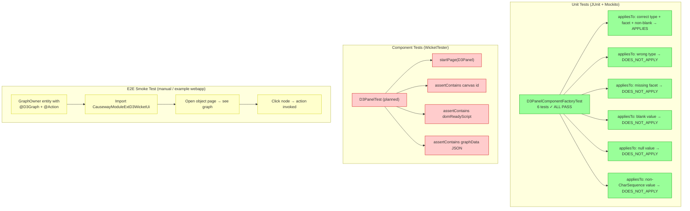

# D3 Wicket Viewer (UI Module) — Implementation Overview

> **Date:** 14 October 2026  
> **Module:** `extensions/vw/d3/wicket/ui` — artifact `causeway-extensions-d3-wicket-ui`  
> **Target package:** `org.apache.causeway.extensions.d3.wkt.ui`

---

## 1. Problem Statement

A domain entity may expose a property annotated with `@D3Graph` whose value is a
JSON string describing a force-layout graph (`{ nodes: [...], links: [...] }`).
The Wicket UI module must:

1. **Render** that property as an interactive D3.js force-layout graph on the
   entity's object page.
2. **Handle node clicks** by invoking a configurable domain action on the owning
   entity, passing the clicked node's id as the action's first `String` parameter.

The solution reuses the existing `extensions/vw/d3/wicket/integration` module
that provides the D3.js canvas, the `d3-integration.mjs` client-side script,
and the AJAX callback infrastructure.

---

## 2. Module Landscape



### Module responsibilities

| Module | Key exports | Role |
|---|---|---|
| **applib** | `@D3Graph`, `D3Config`, `D3GraphAdvisor` | Domain annotation, config DTO, SPI for dynamic config |
| **metamodel** | `D3GraphFacet`, `D3GraphFacetFromAnnotationFactory` | Scans `@D3Graph`, attaches facet to properties/actions |
| **wicket/integration** | `D3Panel`, `NodeClickedCallback`, `D3AjaxCallback`, `d3-integration.mjs` | Generic D3.js canvas, AJAX callback URL wiring, client-side script |
| **wicket/ui** (this module) | `CausewayModuleExtD3WicketUi`, `D3PanelComponentFactory`, UI `D3Panel` | Glue: picks up `D3GraphFacet`, creates panel from property value, wires action invocation on node click |

---

## 3. New Classes — Architecture

### 3.1 Class diagram



### 3.2 File layout

```
extensions/vw/d3/wicket/ui/src/main/java/org/apache/causeway/extensions/d3/wkt/ui/
    CausewayModuleExtD3WicketUi.java          -- Spring @Configuration entry point
    components/
        D3Panel.java                          -- UI panel (extends integration D3Panel)
        D3PanelComponentFactory.java           -- Wicket ComponentFactory
```

No additional `.html` markup is needed — the UI `D3Panel` inherits the integration
module's `D3Panel.html`.

---

## 4. End-to-End Scenarios

### 4.1 Page Load — Render the graph



### 4.2 Node Click — Invoke domain action



### 4.3 Decision tree — `appliesTo`



### 4.4 Callback wiring detail



---

## 5. Test Strategy



### Test dependency

| Dependency | Version | Used for |
|---|---|---|
| `junit-jupiter` | (BOM-managed) | Test runner |
| `mockito-core` / `mockito-junit-jupiter` | (BOM-managed) | Mocking `UiAttributeWkt`, `ObjectFeature`, `ManagedObject` |
| `MetaModelContext_forTesting` | (project test-jar from `viewers/commons/testsupport`) | Lightweight `MetaModelContext` without full container |
| `wicket-tester` | `${wicket.version}` (10.10.0) | `WicketTester` for component rendering tests |

> **Note:** `wicket-tester` is declared in `pom.xml` but panel-level tests (`D3PanelTest`)
> were removed pending a rewrite. The `createComponent` test in `D3PanelComponentFactoryTest`
> is disabled with `//TODO` because it requires a full Wicket request cycle.

---

## 6. Key Design Decisions

1. **Attribute-level factory, not object-level.**  
   The `D3GraphFacet` is attached to *properties/actions only* (the metamodel factory
   processes `PROPERTIES_AND_ACTIONS`). The UI factory registers for
   `UiComponentType.ATTRIBUTE_NAME_AND_VALUE`, matching the PDF.js extension pattern.

2. **Extends integration `D3Panel`, no new `.html`.**  
   The UI `D3Panel` subclasses the integration module's panel, inheriting its
   `D3Panel.html` markup, D3.js library references, and callback-URL wiring.
   Only the *data* (graph JSON) and *behavior* (action invocation) are added.

3. **Graph data from the property value.**  
   The annotated property's value (a JSON `String`) is pushed into `D3Config`
   via `withGraphData(...)`. This is the primary source; advisor-provided
   `graphData` is not merged by the facet today (documented gap).

4. **Action invocation via `FormExecutorDefault`.**  
   On node click, the panel resolves the domain action by member id, builds an
   `ActionModel`, sets the first parameter to the clicked node id via
   `updateParamValuePojo(0, __ -> event.nodeId())`, and delegates to
   `FormExecutorDefault.forAction(actionModel).executeAndProcessResults(...)`.
   This reuses the standard Wicket viewer's action-execution pipeline (parameter
   validation, result handling, page update).

5. **No separate CSS file (optional).**  
   A small `D3Panel.css` was considered but not implemented. The integration
   panel already contributes D3.js CSS via `D3Reference`.

---

## 7. Gaps & Future Work

| Area | Status | Notes |
|---|---|---|
| **TYPE-level `@D3Graph`** | Unsupported | `@Target` includes `TYPE`, but metamodel factory only processes `PROPERTIES_AND_ACTIONS` |
| **Advisor `graphData` merge** | Not merged | `configFor(...)` merges advisor width/height/drag/zoom/clickAction but not graph data |
| **`D3Panel.css`** | Optional | Not yet created; would require a `CssReference` in `renderHead` |
| **Canvas cleanup** | Optional | Override `onRemove`/`onDetach` to call `WicketStuff.D3.destroy(canvasId)` |
| **Antora docs** | Not started | User-facing page for the D3 viewer extension |
| **`ui-test` module** | Not started | Long-term Wicket-level regression tests (like `viewers/wicket/ui-test`) |

---

## 8. Quick Reference — Key API Signatures

### Source of truth (verified on disk)

| API | File |
|---|---|
| `UiAttributeWkt.getMetaModel()` → `ObjectFeature` (FacetHolder) | `viewer/wicket/model/.../UiAttributeWkt.java` |
| `UiAttributeWkt.getObject()` → `ManagedObject` | same |
| `UiAttributeWkt.getParentUiModel()` → `UiObjectWkt` | same |
| `ManagedObject.getPojo()` → `Object` | `core/metamodel/.../ManagedObject.java` |
| `ManagedObject.adaptSingular(ObjectSpec, Object)` | same |
| `ObjectFeature.containsFacet(Class)` → `boolean` | `core/metamodel/.../ObjectFeature.java` |
| `ObjectFeature.lookupFacet(Class)` → `Optional<? extends Facet>` | same |
| `ObjectSpecification.getAction(String)` → `Optional<ObjectAction>` | `core/metamodel/.../ObjectSpecification.java` |
| `ObjectSpecification.getCorrespondingClass()` → `Class<?>` | same |
| `D3GraphFacet.configFor(Class)` → `D3Config` | `extensions/vw/d3/metamodel/.../D3GraphFacet.java` |
| `D3GraphFacet.getClickAction(Class)` → `Optional<String>` | same |
| `ActionModel.forEntity(ObjectAction, UiObjectWkt)` | `viewer/wicket/model/.../ActionModel.java` |
| `ActionModel.getActionInteraction()` → `ActionInteractionWkt` | same |
| `ActionInteractionWkt.startParameterNegotiation()` → `Optional<ParameterNegotiationModel>` | same |
| `ParameterNegotiationModel.updateParamValuePojo(int, Function)` | `viewer/commons/model/.../ParameterNegotiationModel.java` |
| `FormExecutorDefault.forAction(ActionModel)` | `viewer/wicket/ui/.../FormExecutorDefault.java` |
| `FormExecutorDefault.executeAndProcessResults(AjaxRequestTarget, Form, FormExecutorContext)` | same |

### Build / run commands

```bash
# unit tests only
mvn -pl extensions/vw/d3/wicket/ui -am -Dtest=D3PanelComponentFactoryTest test

# full module build
mvn -pl extensions/vw/d3/wicket/ui -am install
```
